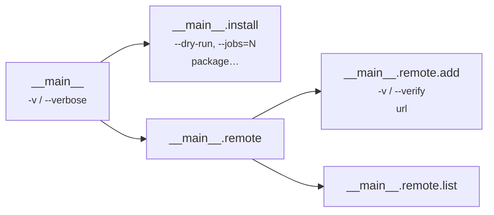

# Nested command tree

A small package manager, `pkg`, with a `remote` command group that has
children of its own. It combines a root-level flag, two `subcommands`
levels, two `positionals` leaves, a `none` leaf, and a short alias reused
at a different level. Because the declaration is flat, each command is one
top-level entry; the tree is visible in the `subcommands` lists.



```yaml title="pkg.korml"
version: kaira.command-declaration/v1
program: pkg
commands:
  __main__:
    shape: subcommands
    flags:
      verbose: {short: v}
    subcommands: [__main__.install, __main__.remote]

  __main__.install:
    shape: positionals
    flags:
      dry-run: {}
    options:
      jobs: {style: attached}
    positionals:
      - package: {alignment: center, multiplicity: multiple}

  __main__.remote:
    shape: subcommands
    subcommands: [__main__.remote.add, __main__.remote.list]

  __main__.remote.add:
    shape: positionals
    flags:
      verify: {short: v}          # (1)!
    positionals:
      - url: {alignment: left}

  __main__.remote.list:
    shape: none
```

1.  `__main__` uses `-v` for `verbose`; `__main__.remote.add` reuses `-v` for
    `verify`. Aliases are unique within a command, not across the tree.

| Command line | Outcome |
| --- | --- |
| `pkg -v install --jobs=4 left-pad is-odd --dry-run` | accepted — see below |
| `pkg remote add -v https://example.org/index` | accepted — three records; at the third level `-v` means `verify` |
| `pkg remote` | `missing_subcommand` at 1 — a `subcommands` command always requires a child |
| `pkg install -v left-pad` | `unknown_option` at 1 — `verbose` belongs to `__main__`; inside `install` it is unknown |
| `pkg --jobs=4 install left-pad` | `unknown_option` at 0 — `jobs` belongs to `install` |
| `pkg install` | `too_few_positionals` at 1 — `install` requires at least one package |
| `pkg remote add a b` | `too_many_positionals` at 3 — `url` takes exactly one word |
| `pkg remote list extra` | `unexpected_argument` at 2 — `list` has `shape: none` |
| `pkg remote -v add x` | `unknown_option` at 1 — `remote` itself declares no flags |
| `pkg` | `missing_subcommand` at 0 |

For `pkg -v install --jobs=4 left-pad is-odd --dry-run`:

```json
{
  "program": "pkg",
  "command": "__main__.install",
  "path": ["__main__", "__main__.install"],
  "commands": {
    "__main__": {"flags": ["verbose"], "options": {}, "positionals": {}},
    "__main__.install": {
      "flags": ["dry-run"],
      "options": {"jobs": "4"},
      "positionals": {"package": ["left-pad", "is-odd"]}
    }
  }
}
```

For `pkg remote add -v https://example.org/index`:

```json
{
  "program": "pkg",
  "command": "__main__.remote.add",
  "path": ["__main__", "__main__.remote", "__main__.remote.add"],
  "commands": {
    "__main__":            {"flags": [], "options": {}, "positionals": {}},
    "__main__.remote":     {"flags": [], "options": {}, "positionals": {}},
    "__main__.remote.add": {"flags": ["verify"], "options": {}, "positionals": {"url": "https://example.org/index"}}
  }
}
```

Scopes are strict in both directions: a parent flag used in a child and a
child option used in a parent are both `unknown_option`. Order inside a
level is free (`--dry-run` may follow the package names), order across
levels is not (`-v` for `verbose` must precede `install`). Every selected
command appears in `commands`, including a pass-through level such as
`__main__.remote` that declared nothing.
