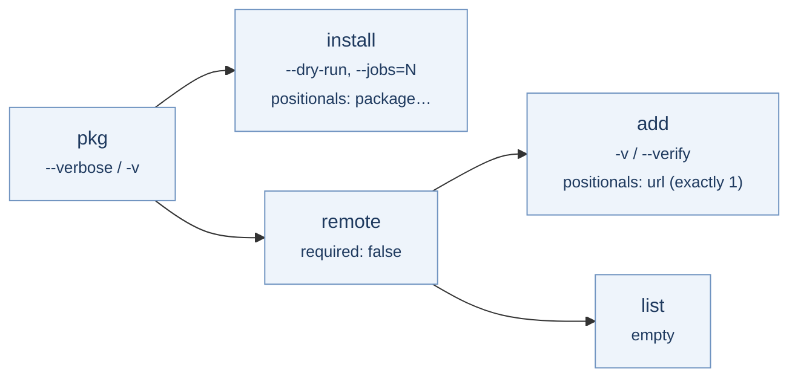

# Nested command tree

This example models a small package manager, `pkg`, with a `remote`
command group that has children of its own. It combines a root-level flag,
`subcommands` tails with and without `required`, a `positionals` leaf, and
a short alias reused at a different level.



## Declaration

```yaml title="pkg.korml"
version: kaira.command-declaration/v1
program: pkg

command:
  options:
    verbose:
      flag:
        short: v
  tail:
    subcommands:
      required: true
      commands:

        install:
          options:
            dry-run:
              flag: {}
            jobs:
              scalar:
                value: int
                value_style: attached
          tail:
            positionals:
              positionals:
                name: package
                value: string
                min: 1
                max: unbounded

        remote:
          tail:
            subcommands:
              required: false # (1)!
              commands:
                add:
                  options:
                    verify:
                      flag:
                        short: v # (2)!
                  tail:
                    positionals:
                      positionals:
                        name: url
                        value: string
                        min: 1
                        max: 1
                list:
                  tail:
                    empty: {}
```

1.  `pkg remote` on its own is valid and stops at the `remote` level.
2.  The root uses `-v` for `verbose`; `remote add` reuses `-v` for `verify`.
    Aliases are unique within a level, not across the tree.

## Verdicts

=== ":material-check-circle: Accepted"

    ```console
    $ pkg -v install --jobs=4 left-pad is-odd --dry-run
    ```

    ```json
    {
      "program": "pkg",
      "command_path": ["install"],
      "levels": [
        {"options": {"verbose": true}, "positionals": null},
        {
          "options": {"jobs": "4", "dry-run": true},
          "positionals": {"package": ["left-pad", "is-odd"]}
        }
      ]
    }
    ```

    ```console
    $ pkg remote add -v https://example.org/index
    ```

    ```json
    {
      "program": "pkg",
      "command_path": ["remote", "add"],
      "levels": [
        {"options": {}, "positionals": null},
        {"options": {}, "positionals": null},
        {"options": {"verify": true}, "positionals": {"url": ["https://example.org/index"]}}
      ]
    }
    ```

    Three command levels, three entries in `levels`. At the third level
    `-v` means `verify`, not `verbose`.

    ```console
    $ pkg remote
    ```

    Valid, because `remote` declares `required: false`. The result has two
    levels and `"command_path": ["remote"]`.

=== ":material-close-circle: Rejected"

    | Command line | Error | Why |
    | --- | --- | --- |
    | `pkg install -v left-pad` | `unknown_option` at 1 | `verbose` belongs to the root; inside `install` it is unknown. |
    | `pkg --jobs=4 install left-pad` | `unknown_option` at 0 | `jobs` belongs to `install`; at the root it is unknown. |
    | `pkg install` | `too_few_positionals` at 1 | `install` requires at least one package. |
    | `pkg remote add a b` | `too_many_positionals` at 3 | `url` allows exactly one value. |
    | `pkg remote list extra` | `unexpected_argument` at 2 | `list` has an `empty` tail. |
    | `pkg remote -v add x` | `unknown_option` at 1 | `remote` itself declares no options. |
    | `pkg` | `missing_subcommand` at 0 | The root requires a child. |

## Remarks

- **Scopes are strict in both directions.** A parent option used in a child
  and a child option used in a parent are both `unknown_option`.
- **Order inside a level is free; order across levels is not.** `--dry-run`
  may come after the package names, but `-v` for `verbose` must come before
  `install`.
- **Every selected level appears in the result,** even a pass-through level
  like `remote` that declared no options.
