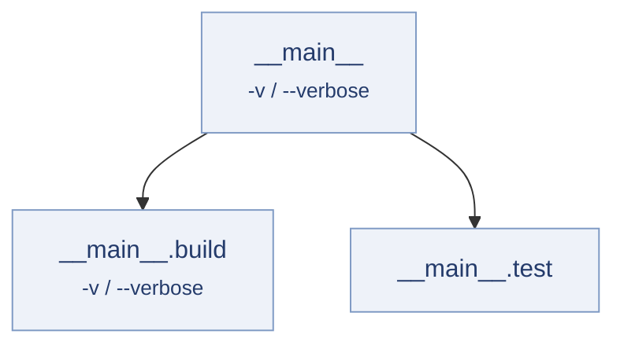

# Subcommands

The root lists two children. `__main__` and `__main__.build` both declare
a `verbose` flag with the same short alias — legal, because names and
aliases are scoped per command.



```yaml title="kaira.korml"
version: kaira.command-declaration/v1
program: kaira
commands:
  __main__:
    shape: subcommands
    flags:
      verbose: {short: v}
    subcommands: [__main__.build, __main__.test]   # (1)!
  __main__.build:
    shape: none
    flags:
      verbose: {short: v}                           # (2)!
  __main__.test:
    shape: none
```

1.  The user types the last segment of the key: `build`, `test`. A
    `subcommands` command always requires one of them.
2.  A child may declare the same name and alias as its parent; each level
    has its own scope.

| Command line | Outcome |
| --- | --- |
| `kaira build`, `kaira test` | accepted |
| `kaira -v build -v` | accepted — see below |
| `kaira` | `missing_subcommand` at 0 — the index is `argv.length`. |
| `kaira clean` | `unknown_subcommand` at 0 — `clean` is not a listed child's word. |
| `kaira build target` | `unexpected_argument` at 1 — `build` has `shape: none`. |
| `kaira test -v` | `unknown_option` at 1 — `test` declares no flags; the root's `-v` is out of scope. |
| `kaira build -v -v` | `duplicate_option` at 2 — a flag may appear at most once per level. |
| `kaira -- build` | `unexpected_delimiter` at 0 — `--` never selects a subcommand. |

For `kaira -v build -v`, each level records its own `verbose`:

```json
{
  "program": "kaira",
  "command": "__main__.build",
  "path": ["__main__", "__main__.build"],
  "commands": {
    "__main__":       {"flags": ["verbose"], "options": {}, "positionals": {}},
    "__main__.build": {"flags": ["verbose"], "options": {}, "positionals": {}}
  }
}
```
