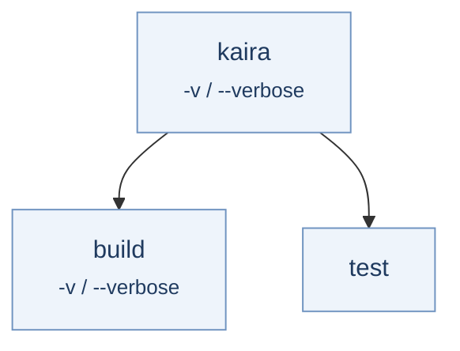

# Subcommands

This example declares a root command with two subcommands, `build` and
`test`. The root and `build` both declare a `verbose` flag with the same
short alias — legal, because aliases are scoped per level.



## Declaration

```yaml title="kaira.korml"
version: kaira.command-declaration/v1
program: kaira

command:
  help: Root command.
  options:
    verbose:
      flag:
        short: v
  tail:
    subcommands:
      required: true # (1)!
      commands:
        build:
          help: Build the project.
          options:
            verbose: # (2)!
              flag:
                short: v
          tail:
            empty: {}

        test:
          help: Run tests.
          tail:
            empty: {}
```

1.  With `required: true`, the command line must select a child.
2.  A child may declare the same long name and short alias as its parent.
    Each level has its own option scope.

## Verdicts

=== ":material-check-circle: Accepted"

    ```console
    $ kaira build
    $ kaira test
    $ kaira -v build -v
    ```

    The last line produces one level per command, each with its own
    `verbose`:

    ```json
    {
      "program": "kaira",
      "command_path": ["build"],
      "levels": [
        {"options": {"verbose": true}, "positionals": null},
        {"options": {"verbose": true}, "positionals": null}
      ]
    }
    ```

=== ":material-close-circle: Rejected"

    | Command line | Error | Why |
    | --- | --- | --- |
    | `kaira` | `missing_subcommand` at 0 | The tail is `required: true`; the index is `argv.length`. |
    | `kaira clean` | `unknown_subcommand` at 0 | `clean` is not a declared child. |
    | `kaira build target` | `unexpected_argument` at 1 | `build` has an `empty` tail. |
    | `kaira test -v` | `unknown_option` at 1 | `test` declares no options; the root's `-v` is out of scope. |
    | `kaira build -v -v` | `duplicate_option` at 2 | A flag may appear at most once per level. |
    | `kaira -- build` | `unexpected_delimiter` at 0 | `--` never selects a subcommand. |

## Optional command stop

Set `required: false` (the default) to allow the command line to stop at
the parent.

```yaml
tail:
  subcommands:
    required: false
    commands:
      build:
        tail:
          empty: {}
```

Both of these are now valid:

```console
$ kaira
$ kaira build
```

The first yields a single root level with `"command_path": []`; the second
yields two levels and `"command_path": ["build"]`.
