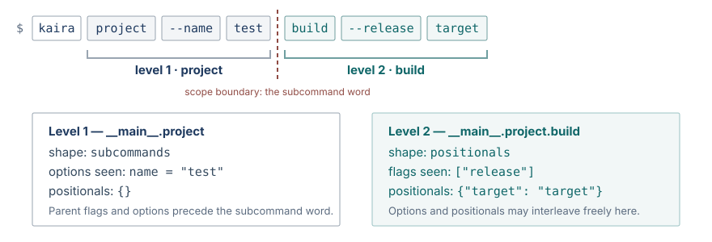
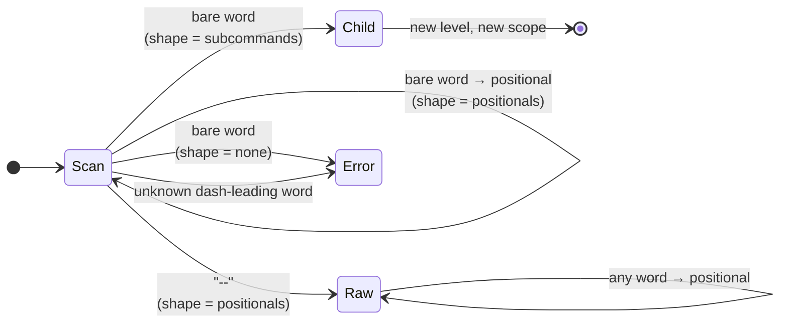

# Command-line grammar

Kaira separates two concerns: a **command declaration language** (KORML)
that lists a program's commands, and a **fixed `argv` interpreter** that
reads command-line words using that declaration. The interpreter is
generic; it knows only what the declaration permits.

## Command levels

A Kaira command line is parsed as a sequence of *command levels*. The root
command `__main__` is the first level; every selected subcommand opens the
next.

```text
program [root flags/options] subcommand [child flags/options and positionals, interleaved]
```

Each level is one entry of `commands` and has zero or more flags and
options and exactly one `shape`:

| `shape` | Meaning |
| --- | --- |
| `none` | The command accepts no bare words at all. |
| `subcommands` | The first bare word must be the word of a listed child command. |
| `positionals` | Bare words are positional values; flags and options may be interleaved freely. |

A level cannot both select subcommands and accept positional values. That
restriction is what makes the grammar unambiguous: a bare word is *always*
either a subcommand word or a positional value, never "whichever fits".

## Scopes

Flags and options belong to the level where they are declared. Consider a
program `kaira` with a `project` subcommand that itself has a `build`
subcommand:

```yaml
commands:
  __main__:               {shape: subcommands, subcommands: [__main__.project]}
  __main__.project:       {shape: subcommands, subcommands: [__main__.project.build],
                           options: {name: {value: string, style: spaced}}}
  __main__.project.build: {shape: positionals, flags: {release: {}},
                           positionals: [{target: {alignment: left, value: string}}]}
```

```console
$ kaira project --name test build --release target
```

<figure class="kaira-figure" markdown>

<figcaption>The subcommand word is a hard boundary. Everything before it belongs to the parent; everything after it belongs to the child.</figcaption>
</figure>

The first bare word in a `subcommands` level selects the child and
**irreversibly** opens its scope. Parent flags and options may appear only
before that word; child flags and options may appear only after it. There
are no inherited or "global" options: if two levels need the same switch,
each declares it. A `subcommands` level always requires a child; there is
no stopping at the parent.

Within a `positionals` level, by contrast, flags, options, and positional
values may interleave. If `release` is a declared flag of `build`:

```console
$ kaira project build target --release
```

yields `"flags": ["release"]` and `"positionals": {"target": "target"}`
for `__main__.project.build`. A flag or option that appears after a
positional word is still a flag or option.

## Subcommand or positional?

The current level's `shape` decides, and it decides the same way for every
bare word at that level.



- With `shape: subcommands`, `kaira project build` descends into the child
  whose word is `build`; any other bare word is `unknown_subcommand`.
- With `shape: positionals`, `kaira build target1 target2` yields two
  positional words, to be assigned to slots at end of input.
- With `shape: none`, any bare word is `unexpected_argument`.

## Flags and options

A **flag** has no value:

```text
--verbose
```

An **option** takes exactly one value per occurrence and declares one of
two value styles.

=== "spaced"

    The value is the **next word**.

    ```text
    --option value
    ```

    The value may itself begin with a dash (`--threshold -1` is fine).
    The only word a spaced option refuses is the exact delimiter `--`,
    which produces `missing_value`.

=== "attached"

    The value follows the **first `=`** in the same word.

    ```text
    --option=value
    ```

    Everything after the first `=` is the value, including further `=`
    signs or nothing at all. `--output=--` therefore passes the literal
    value `--`.

The two styles are not aliases of each other. An option declared `spaced`
rejects the attached form, and one declared `attached` rejects the spaced
form, in both cases with `invalid_option_form`.

### Multiplicity

| Declaration | Occurrences | Values | Result |
| --- | --- | --- | --- |
| flag | at most once | none | name listed in `flags` |
| option, `single` (default) | at most once | one | one value |
| option, `multiple` | any number | one per occurrence | array, in occurrence order |
| option, `multiple` with `separator` | at most once | one, split on the separator | array, in piece order |

=== "Repeated occurrences"

    ```console
    $ kaira --include src --include include --include tests target
    ```

    ```json
    {"include": ["src", "include", "tests"]}
    ```

=== "Separator"

    ```console
    $ kaira --features "mpi;cuda;openmp" target
    ```

    ```json
    {"features": ["mpi", "cuda", "openmp"]}
    ```

    Empty pieces are preserved: with separator `;`, the value `;a;;` splits
    into `["", "a", "", ""]`.

Multiplicity and value style are independent. For a separator option
declared `spaced`:

```console
$ kaira --features "mpi;cuda;openmp" target   # accepted
$ kaira --features=mpi;cuda;openmp target     # rejected: invalid_option_form
```

For the same option declared `attached`, the two verdicts swap. Either way,
the word that reaches Kaira must contain the semicolons, so most shells
need quotes:

```console
$ kaira --features='mpi;cuda;openmp' target
```

!!! note "Quoting is the shell's job"

    Kaira never sees quotes. It sees the word `--features=mpi;cuda;openmp`
    and nothing else. The quoting above only stops the shell from treating
    `;` as a command separator.

## Positional slots

A `positionals` command declares an ordered list of named *slots*. Each
slot has a value type, an `alignment`, and a count range derived from
`multiplicity`, `required`, and an optional `cardinality`:

| `multiplicity` | `required` | Count |
| --- | --- | --- |
| `single` | `true` (default) | exactly 1 |
| `single` | `false` | 0 or 1 |
| `multiple` | `true` | 1 or more (or `cardinality.min`…`cardinality.max`) |
| `multiple` | `false` | 0 or more (or `0`…`cardinality.max`) |

Positional words are collected during the scan and assigned to slots at
end of input, in the effective order: all `left` slots, then the `center`
slot, then all `right` slots. The declaration must satisfy two conditions:

1. A `left` or `right` slot has a fixed count (`min = max`).
2. At most one slot is `center`, and only that slot may have a variable
   count.

Under these conditions the assignment is unique for every word count: the
fixed slots take their counts, and the centre slot takes whatever remains,
which must lie within its range. For example

```yaml
positionals:
  - command:   {alignment: left,   value: string}
  - arguments: {alignment: center, value: string, multiplicity: multiple, required: false}
  - log:       {alignment: right,  value: string}
```

with `run make -j4 all build.log` gives `command = "make"`,
`arguments = ["-j4", "all"]`, `log = "build.log"` — provided `-j4` was
preceded by `--`; without it, `-j4` is an unknown option. With fewer than
two words the parse fails with `too_few_positionals`.

A declaration with two variable slots, or a variable `left` or `right`
slot, is `invalid_declaration`.

## The `--` delimiter

The exact word `--` ends **option recognition** at the current level. It
does not end parsing: every remaining word becomes a positional word of
the current command, including words that look like options, subcommands,
or further delimiters.

```console
$ kaira run -- --not-an-option build --help
```

Positional words of `run`: `--not-an-option`, `build`, `--help`.

The delimiter may follow earlier positional values:

```console
$ kaira run input -- --not-an-option --help
```

Because `--` is only meaningful for `shape: positionals`, it is an error
(`unexpected_delimiter`) on `none` or `subcommands`. In particular,
`kaira project -- build` does **not** select the `build` subcommand.

Without a delimiter, declared flags and options are recognized anywhere in
a `positionals` level, and any undeclared dash-leading word is
`unknown_option`.

## The literal value `--`

A spaced option cannot receive `--` as its value, because the delimiter is
checked first:

```console
$ kaira --output --     # missing_value at the index of --output
```

An option that must carry the literal value `--` is declared
`style: attached`:

```console
$ kaira --output=--
```

Other dash-leading values are fine for spaced options:

```text
--threshold -1
--pattern --foo
```
