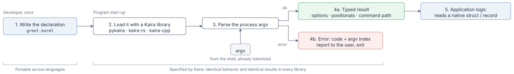

<div class="kaira-intro" markdown>

# Kaira

Kaira is a specification for declaring command-line interfaces and for
interpreting argument vectors against such declarations. A declaration is
written in KORML and describes a program's command tree: its options,
subcommands, and positional arguments. The specification fixes the
declaration format, its validation rules, the interpretation procedure, and
a portable result representation, so that independent implementations in
different languages produce identical results and error codes for identical
inputs.

[Getting started](getting-started/index.md){ .md-button }
[Specification](reference/specification.md){ .md-button }
[Examples](examples/index.md){ .md-button }

<small>Version 1, draft. `src/SPECIFICATION.md` in the repository is normative; these pages are explanatory.</small>

</div>

## Overview

<figure class="kaira-figure" markdown>

<figcaption>Using Kaira in a program. The declaration is written once; steps 2–4 are performed by the library and behave identically in every language.</figcaption>
</figure>

=== ":material-file-code: Declaration"

    ```yaml title="example.korml"
    version: kaira.command-declaration/v1
    program: example
    command:
      options:
        verbose:
          flag:
            short: v # (1)!
      tail:
        positionals: # (2)!
          positionals:
            name: input
            value: string
            min: 1
            max: 1
    ```

    1.  Short aliases exist only when declared. Kaira never derives `-v` from `verbose` on its own.
    2.  Every command has exactly one tail mode. This one accepts a single positional value named `input`.

=== ":material-console: Command line"

    ```console
    $ example -v report.txt
    ```

    The shell has already split the line into words, so the parser receives:

    ```json
    ["-v", "report.txt"]
    ```

=== ":material-check-circle: Portable result"

    ```json
    {
      "program": "example",
      "command_path": [],
      "levels": [
        {
          "options": {"verbose": true},
          "positionals": {"input": ["report.txt"]}
        }
      ]
    }
    ```

    Result keys are the declared long option names, irrespective of the spelling used on the command line.

=== ":material-close-circle: Portable error"

    ```console
    $ example -v
    ```

    ```json
    {"code": "too_few_positionals", "index": 1}
    ```

    An error consists of a code from a closed set and a zero-based index into `argv`. Diagnostic text is implementation-defined.

## Properties

Determinism
:   The interpretation of an argument vector is a function of the declaration
    and the vector alone. The grammar contains no abbreviation, short-option
    clustering, implicit aliases, or implicit options; recognized spellings
    are exactly those declared. See [Design goals](explanation/design-goals.md).

Value portability
:   Results use JSON-compatible types. `int` and `float` arguments are
    validated lexically and carried as their original decimal text, so
    acceptance and representation are independent of host-language numeric
    types. See [Portable results](reference/results.md).

Scoped command levels
:   Each selected subcommand opens a new command level with its own option
    scope; option declarations are never inherited across levels. See
    [Command-line grammar](explanation/grammar.md).

Conformance
:   A language-neutral vector file specifies the expected result or error
    code and index for each case. See
    [Conformance suite](reference/results.md#conformance-suite).

## Scope

| Specified | Out of scope |
| --- | --- |
| The KORML declaration format and its validation rules | Implementation APIs and data structures |
| The per-level interpretation of options, subcommands, and positionals | Shell tokenization, quoting, and escaping |
| The portable result representation and error codes | Diagnostic messages and help output |
| Four primitive value types with exact lexical grammars | Application-level types (paths, dates, enumerations) |
| A language-neutral conformance suite | Default values, environment variables, configuration files |

!!! note "Status"

    Version 1 is a draft. Once it is declared stable, any change that affects
    results or error categories requires a new declaration version.

## Contents

| Section | Content |
| --- | --- |
| [Getting started](getting-started/index.md) | Using Kaira in a program; [writing a declaration](getting-started/writing-a-declaration.md). |
| [Explanation](explanation/index.md) | [Design goals](explanation/design-goals.md) and the [command-line grammar](explanation/grammar.md). |
| [Reference](reference/index.md) | The [normative specification](reference/specification.md), [KORML schema](reference/schema.md), [parser rules](reference/parser-rules.md), [results and conformance](reference/results.md), [error codes](reference/errors.md), and [implementation and conformance](reference/implementation.md). |
| [Examples](examples/index.md) | Complete declarations with accepted and rejected argument vectors. |
