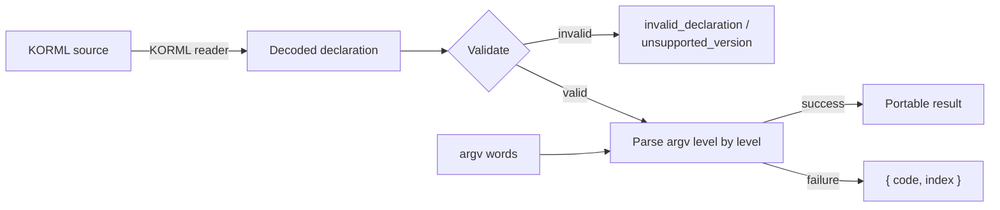

# Implementation and conformance

!!! note "Audience"

    This page is for authors of Kaira libraries. Users of an existing
    library do not need it; see [Getting started](../getting-started/index.md).

A Kaira implementation consists of a declaration validator and a per-level
scanner. This page complements the
[normative specification](../reference/specification.md) with an
implementation checklist and the conformance procedure.

## Structure



The specification prescribes the declaration format, the validation rules,
the parsing procedure, and the output representation. The public API,
diagnostic presentation, and any typed accessors are
implementation-defined.

## Checklist

- [ ] **Read KORML faithfully.** Accept a KORML v0 source or a KORML v1.0
      stream with exactly one document. Reject duplicate mapping keys and
      malformed documents as `invalid_declaration`. Preserve keys and scalar
      text byte for byte.
- [ ] **Decode scalars as specified.** Booleans are exactly `true` or
      `false`; integers are `0` or a decimal number without sign or leading
      zero, at most 2⁶³ − 1; quoting style is not significant.
- [ ] **Validate the whole declaration before parsing anything.** Check
      `version` first: any scalar other than `kaira.command-declaration/v1`
      is `unsupported_version`, whatever else the document contains. Then
      exactly three root fields; `commands` contains `__main__`; unknown
      fields are errors everywhere.
- [ ] **Check the tree.** Every listed child key exists, `__main__` is
      never listed, every other key is listed by exactly one parent, every
      key is reachable from `__main__`, and the words of one parent's
      children are distinct.
- [ ] **Enforce the per-command constraints.** `subcommands` present iff
      `shape: subcommands`, `positionals` present iff `shape: positionals`;
      long names and short aliases distinct across flags and options; a
      nonempty `separator` only with `multiplicity: multiple`; no `value`
      field anywhere.
- [ ] **Enforce the slot rules.** Effective bounds from `multiplicity`,
      `required`, and `cardinality` must agree; every slot has `max ≥ 1`;
      `left`/`right` slots have a fixed count; at most one `center` slot,
      the only one allowed to vary; the sums of the slot minima and finite
      maxima of one command are at most 2⁶³ − 1.
- [ ] **Keep `argv[0]`.** Do not strip the invocation name; start scanning
      at index 1 and report indices into the complete vector. An empty
      `argv` is `empty_argv`.
- [ ] **Scan each level left to right** following the
      [parser rules](../reference/parser-rules.md). Keep fresh flag, option,
      and positional-word collections per level. Check each option word
      in the order recognition, form, occurrence, value. Stop recognizing
      options after `--`. Descend into a subcommand immediately and never
      look back.
- [ ] **Assign positional words to slots at end of input**, fixed slots
      first, the remainder to the centre slot.
- [ ] **Leave values alone.** No trimming, conversion, or validation; the
      only operation on a value is splitting on a declared `separator`.
- [ ] **Produce the portable result** with exactly `program`, `command`,
      `path`, and `commands`; one record per selected key with `flags`,
      `options`, and `positionals`; omit absent options and empty slots;
      `single` yields a value, `multiple` an array.
- [ ] **Report errors in the prescribed order**: `empty_argv`, then scan
      errors at the first failing word, then `missing_subcommand` /
      `too_few_positionals` at `argv.length`.
- [ ] **Pass the conformance suite.**

## Running the conformance suite

`tests/conformance/v1.json` is a plain JSON document with three sections.

```json title="tests/conformance/v1.json (abridged)"
{
  "format": "kaira.conformance/v1",
  "declarations": {
    "options": { "version": "kaira.command-declaration/v1", "program": "app", "commands": { "__main__": { "…": "…" } } }
  },
  "cases": [
    {
      "id": "short-attached",
      "declaration": "options",
      "argv": ["app", "-o=--"],
      "ok": { "program": "app", "command": "__main__", "path": ["__main__"], "commands": { "…": "…" } }
    },
    {
      "id": "missing-spaced-value",
      "declaration": "options",
      "argv": ["app", "--include", "--"],
      "error": { "code": "missing_value", "index": 1 }
    }
  ],
  "invalid_declarations": [
    { "id": "empty-separator", "declaration": { "…": "…" }, "error": { "code": "invalid_declaration" } }
  ]
}
```

A harness in any language does the same four things:

1.  For each entry in `declarations`, pass the already-decoded value to the
    validator and retain the validated declaration by name.
2.  For each entry in `cases`, look up the declaration, parse `argv`, and
    compare the outcome: a case has exactly one of `ok` or `error`. Compare the portable
    result structurally (object key order is immaterial, array order is not)
    and compare errors by `code` and `index` only.
3.  For each entry in `invalid_declarations`, assert that validation fails
    with the given `code` and no `index`.
4.  Separately, test that the KORML front end rejects malformed documents
    and duplicate keys. The JSON vectors are already decoded and therefore do
    not exercise that layer.

??? example "Sketch of a harness in Python"

    ```python
    import json
    from my_kaira import validate, parse, KairaError

    suite = json.load(open("tests/conformance/v1.json"))
    decls = {name: validate(d) for name, d in suite["declarations"].items()}

    for case in suite["cases"]:
        decl = decls[case["declaration"]]
        try:
            got = {"ok": parse(decl, case["argv"])}
        except KairaError as err:
            got = {"error": {"code": err.code, "index": err.index}}
        expected = {k: case[k] for k in ("ok", "error") if k in case}
        assert got == expected, (case["id"], got, expected)

    for bad in suite["invalid_declarations"]:
        try:
            validate(bad["declaration"])
        except KairaError as err:
            assert err.code == bad["error"]["code"] and err.index is None, bad["id"]
        else:
            raise AssertionError(f'{bad["id"]} was accepted')
    ```

## Frequent nonconformances

!!! failure "Interpreting values"

    `--ratio 1.5e+1000`, `--count=01`, and `--enabled TRUE` are all
    accepted and delivered as strings. An implementation that converts or
    validates values during parsing fails `numbers-are-strings` and
    `true-is-a-string`; typed access, if offered, is a separate accessor.

!!! failure "Expanding `-vo` as two flags"

    The grammar has no short-option clustering. `-vo` is a single
    unrecognized word and is reported as `unknown_option` at its index.

!!! failure "Accepting both `--name value` and `--name=value`"

    Each option declares one value style. The other form is
    `invalid_option_form`.

!!! failure "Resolving parent flags or options inside a child level"

    After a subcommand word is consumed, only the child's declarations are
    in scope. `app test -v` is `unknown_option` at index 2 even when
    `__main__` declares `-v`.

!!! failure "Matching subcommand keys instead of words"

    The user types the word (`build`), not the key (`__main__.build`).
    `["app", "__main__.install", "x"]` is `unknown_subcommand`.

!!! failure "Stripping or interpreting `argv[0]`"

    `argv[0]` stays in the vector and is skipped, whatever it contains; the
    first argument is at index 1. An adapter that strips it reports every
    index one too low.

!!! failure "Checking occurrence before form"

    The checks on an option word run in a fixed order. For an attached
    `single` option, `app --output=a --output b` is `invalid_option_form`
    at 2, not `duplicate_option`.

!!! failure "Re-tokenizing `argv` elements"

    `argv` elements are words. An element may contain whitespace, be empty,
    or be `--` itself (after a delimiter). Implementations do not split,
    trim, or unquote elements.

## Additional testing

The conformance vectors are a minimum. Implementations should additionally
test at least:

- numbers with hundreds of digits in both mantissa and exponent;
- Unicode strings, including combining characters and empty strings;
- every error code at both the first and a later `argv` index;
- repeated options interleaved with positionals and with `--`;
- short-alias collisions across sibling and parent-child levels.

Property-based testing is well suited to the model: generate a random
valid declaration and a random `argv`, and check that the outcome is a
function of those two inputs alone.
