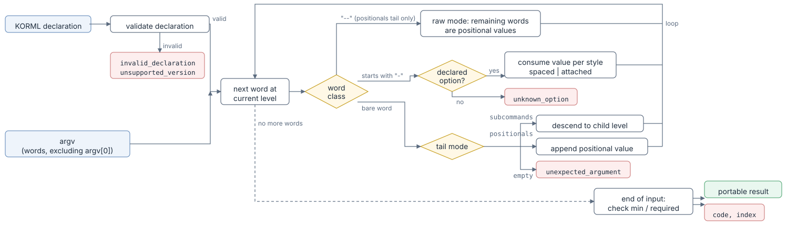

# Parser rules

The Kaira parser is a fixed interpreter for Kaira command declarations. The
normative definition — including validation, output, and error precedence —
is the [specification](specification.md); this page is the working summary.

The shell has already split the command line into `argv` words. Quoting
and escaping are therefore the shell's concern, never Kaira's.

`argv` is passed unchanged, including the invocation name `argv[0]`. Kaira
does not interpret `argv[0]`: scanning starts at index 1, and every error
index counts from `argv[0]`, so an index can be used directly on the host's
argument vector. An empty `argv` is `empty_argv`.

## Per-level parsing

Parsing starts at `__main__` and proceeds one command level at a time.
Each command declares one of three shapes.

| `shape` | Permitted stream at this level |
| --- | --- |
| `none` | Declared flags and options only. |
| `subcommands` | Declared flags and options, then the word of one listed child; parsing continues in the child's own scope. |
| `positionals` | Declared flags and options freely interleaved with positional words; optionally `--` followed by raw positional words. |

The procedure for one level:

<figure class="kaira-figure" markdown>

<figcaption>Each word is classified and dispatched according to the current level's declaration; a subcommand word opens a new level and the loop continues there.</figcaption>
</figure>

The same procedure as pseudo-code:

```text
parse(argv):
  if argv is empty: error empty_argv
  return parse_level(__main__, argv.after_front)   # argv[0] is skipped

parse_level(command, argv):
  flags = []          # long names, in first-occurrence order
  options = {}
  words = []          # positional words with their argv indices
  raw = false

  while argv is not empty:
    token = argv.front
    if raw:
      words.append(token); check_total_maximum()
    else if token == "--":
      require command.shape is positionals       # else unexpected_delimiter
      raw = true
      consume token
    else if token starts with "-":
      consume_declared_flag_or_option(command)
    else if command.shape is none:
      error unexpected_argument
    else if command.shape is subcommands:
      child = child_whose_word_is(token)         # else unknown_subcommand
      return parse_level(child, argv.after_front)
    else:
      words.append(token); check_total_maximum()

  if command.shape is subcommands: error missing_subcommand
  if command.shape is positionals:
    assign_words_to_slots(words)                 # too_few_positionals
  return record_for_level
```

This is explanatory pseudo-code, not a prescribed API. Occurrence checks
and error precedence are defined normatively in the specification.

## Flag and option parsing

| Declaration | Accepted form | Meaning |
| --- | --- | --- |
| flag | `--name`, `-n` | No value. |
| option, `style: spaced` | `--name value`, `-n value` | The value is the next word. |
| option, `style: attached` | `--name=value`, `-n=value` | The value follows the first `=` in the same word. |

The declaration decides the accepted form. A parser must not accept both
`--name value` and `--name=value` for one option. Short aliases are
explicit, never inferred from long names. Short-option clustering (`-abc`),
short value concatenation (`-ofile`), and abbreviation are not part of the
grammar; such words are `unknown_option`.

With `style: spaced`, the next word is consumed as the value **even if it
begins with a dash** — the only exception is the exact delimiter `--`,
which yields `missing_value`.

With `style: attached`, the value is everything after the first `=`,
including an empty string or further `=` signs. For separator values whose
separator is special to a shell, such as `;`, users must quote or escape so
that the whole word reaches Kaira.

Values are not inspected: an option value is any word (or any suffix after
`=`), delivered to the result unchanged.

### Order of checks

A dash-leading word is checked in a fixed order, and the first failing
check determines the error. The *spelling* is the part before the first
`=`, or the whole word.

1. **Recognition** — the spelling is a declared long or short spelling at
   this level; otherwise `unknown_option`.
2. **Form** — a flag or spaced option has no `=`, an attached option has
   one; otherwise `invalid_option_form`.
3. **Occurrence** — the permitted number of occurrences is not exceeded;
   otherwise `duplicate_option`.
4. **Value** — a spaced option is followed by a word other than `--`;
   otherwise `missing_value`.

For a `single` option `--output` declared `attached`, the command line
`app --output=a --output b` fails the form check at index 2 and is
`invalid_option_form`, although it is also a second occurrence. For a
`single` spaced option `--ratio`, `app --ratio 1 --ratio` is
`duplicate_option` at index 3, although the value is also missing.

## Occurrence rules

Each flag and option has a permitted number of occurrences per level:

| Declaration | Permitted occurrences |
| --- | --- |
| flag | At most once. |
| option, `single` | At most once. |
| option, `multiple` | Any number of times. |
| option, `multiple` with `separator` | At most once. |

Long and short spellings count together: `-v --verbose` is
`duplicate_option`. No flag or option is implicitly required, and absent
ones have no default value.

## Separator rule

An option with `separator` is one occurrence with one value. After the
value is consumed, it is split at every literal, non-overlapping occurrence
of the separator, from left to right. Empty pieces are kept.

```text
--features "mpi;cuda;openmp"     →  ["mpi", "cuda", "openmp"]
--features ";a;;"                →  ["", "a", "", ""]
--features ""                    →  [""]
```

Pieces are delivered as strings; empty pieces are preserved.

## Positional slot assignment

Positional words are collected during the scan and assigned at end of
input. Let the slots in effective order (`left`…, `center`, `right`…) have
bounds `[min, max]` with `max ≥ 1`; `left` and `right` slots have
`min = max`, and only the `center` slot may vary.

1. **During the scan**, if the sum of all `max` values is finite and the
   number of positional words exceeds it, report `too_many_positionals` at
   the offending word.
2. **At end of input**, if the number of positional words is below the
   sum of all `min` values, report `too_few_positionals` at
   `argv.length`. Otherwise give every `left` and `right` slot exactly its
   count, in order, and the remaining words to the `center` slot; the two
   checks guarantee that this number lies within the `center` slot's
   bounds.

Words are not validated; the slot only determines where each word is
placed in the result.

Example with `input` (`left`, 1), `extra` (`center`, 0 or more), `output`
(`right`, 1):

| `argv` | Outcome |
| --- | --- |
| `["app", "a", "b"]` | `input = "a"`, `output = "b"` |
| `["app", "a", "1", "2", "b"]` | `extra = ["1", "2"]` |
| `["app", "a"]` | `too_few_positionals` at 2 |
| `["app", "a", "x", "b"]` | `extra = ["x"]` — words are not typed |
| `["app", "a", "x", "--bad", "b"]` | `unknown_option` at 3 |

## The `--` delimiter

The exact word `--` ends **option recognition** at the current
`positionals` level. It can occur before or after positional words.

After `--`, every remaining word is a positional word of the current
command, including dash-leading words and further `--` words. Without the
delimiter, any declared flag or option is parsed as such even when it
follows a positional word, and any undeclared dash-leading word is
`unknown_option`.

`--` is valid only when the current command has `shape: positionals`. On
`none` or `subcommands` it is `unexpected_delimiter`, and it never selects
a subcommand.

## The literal value `--`

A spaced option cannot receive `--` as its value:

```console
$ kaira --output --        # missing_value
```

Declare the option with `style: attached` and write `--output=--` to pass
the literal value.

## Error precedence

1. `empty_argv`, when `argv` has no elements.
2. Errors detected during the scan, at the first word that fails:
   `unknown_option`, `invalid_option_form`, `duplicate_option`,
   `missing_value` (in the order of checks above), `unexpected_argument`,
   `unknown_subcommand`, `unexpected_delimiter`, `too_many_positionals`.
3. At end of input: `missing_subcommand` or `too_few_positionals`.

See [Error codes](errors.md) for the full list with examples.
