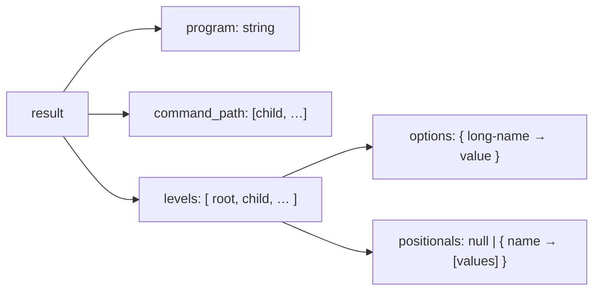

# Portable results and conformance

Kaira makes declaration and argument parsing portable across language
implementations. The common representation uses JSON-compatible types,
although no implementation is required to use JSON internally.

## Successful parse

```json
{
  "program": "kaira",
  "command_path": ["build"],
  "levels": [
    {
      "options": {"verbose": true},
      "positionals": null
    },
    {
      "options": {"output": "build.log", "include": ["src", "inc"]},
      "positionals": {"target": ["app"]}
    }
  ]
}
```



Every selected command level is represented exactly once, root first. The
root command is **not** included in `command_path`. Option keys are the
declared long names even when the user typed a short alias. Absent options
are omitted; they are never filled in with `false`, `null`, or empty arrays.

| Declaration | Portable value when present |
| --- | --- |
| `flag` | Boolean `true`. |
| `scalar` | The validated value: `int` and `float` as their original strings; `string` unchanged; `boolean` as a JSON Boolean. |
| `repeatable` | Array of validated values in occurrence order. |
| `separated` | Array of validated values in piece order. |
| `positionals` | Mapping from the declared name to an array of validated values. |

The representation is the same whether a value came from a spaced option,
an attached option, or a positional argument.

!!! info "Numbers stay text"

    Numeric strings preserve arbitrary-length decimal literals. They never
    become JSON numbers and never undergo host-dependent rounding or
    overflow. `"count": "123456789012345678901234567890"` is exactly what a
    conforming parser emits. Booleans, by contrast, use native JSON `true`
    and `false`. Language bindings may add typed numeric conversions without
    changing this portable representation.

For commands without a positional tail, `positionals` is `null`. For
commands with one, it is a mapping even when no positional values occurred:

```json
{"options": {}, "positionals": {"target": []}}
```

## Errors

Invalid declarations fail before any argument is read and return a `code`
with no `index`:

```json
{"code": "invalid_declaration"}
```

Argument failures return a `code` and a zero-based `index` into the supplied
`argv` (which excludes the executable name). Errors detected at end of
input, such as a missing required subcommand, use `index = argv.length`.

```json
{"code": "missing_value", "index": 2}
```

The full list of codes, with triggering examples, is on the
[Error codes](errors.md) page. Human-readable messages and presentation are
intentionally not standardized.

## Conformance suite

The repository's `conformance/v1.json` contains three sections.

`declarations`
:   Named, already-decoded representations of KORML command declarations.
    JSON is used only as a neutral interchange format for tests.

`cases`
:   Each case names a declaration, supplies an `argv` array, and expects
    exactly one of `ok` (a portable result) or `error` (a `code` and
    `index`).

`invalid_declarations`
:   Declarations that must be rejected during validation, with the expected
    error code and no argument index.

An implementation should load KORML source files with its chosen compatible
KORML reader, then pass the resulting data to its validator and `argv`
parser. The shared JSON cases test the **semantic** layer; they do not
replace tests that the KORML front end rejects malformed documents and
duplicate keys.

The suite currently covers, among other things:

- every error code at least once, including scope violations such as a
  parent option used inside a child;
- numeric literals far beyond 64-bit range, `-0`, exponents with and
  without signs, and rejected spellings such as `+1`, `01`, `NaN`, and
  `Infinity`;
- empty attached values, empty separated pieces, and Unicode strings;
- `--` before, between, and after positionals, and `--` used where it is not
  allowed.

!!! note "Scope of the suite"

    Passing the vectors is necessary but not sufficient. Implementers should
    also exercise very large numbers, Unicode strings, empty values,
    short-alias collisions, and repeated option combinations — ideally with
    property-based tests. See [Implementation and conformance](implementation.md).
