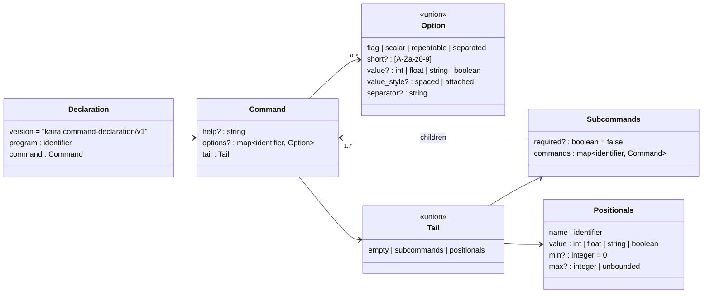

# KORML schema reference

This page explains the Kaira v1 command declaration language. The canonical
schema is `schema/kaira.command-declaration.v1.korml` in the repository;
the listing below is included from that file at build time, so it cannot
drift. The [normative specification](specification.md) adds semantic
checks on top of the schema, and its EBNF grammar is the final authority on
syntactic acceptance.

The schema describes declarations only. It says nothing about the runtime
grammar of `argv`; that is defined in [Parser rules](parser-rules.md).

## The declaration at a glance



## Schema

```yaml title="schema/kaira.command-declaration.v1.korml"
--8<-- "schema/kaira.command-declaration.v1.korml"
```

## Root document

A Kaira declaration has exactly three root fields. Unknown fields,
including leftovers from early drafts, are rejected.

| Field | Required | Meaning |
| --- | --- | --- |
| `version` | yes | Exactly `kaira.command-declaration/v1`. |
| `program` | yes | Program name used at the root of the command tree and copied into results. |
| `command` | yes | Root command declaration. |

```yaml
version: kaira.command-declaration/v1
program: kaira
command:
  tail:
    empty: {}
```

## Command

A command has optional metadata and a required tail.

```yaml
command:
  help: Build the project.
  options:
    verbose:
      flag: {}
  tail:
    positionals:
      positionals:
        name: target
        value: string
        min: 0
        max: unbounded
```

The tail is a union: exactly one of `empty`, `subcommands`, or
`positionals` is present.

### Empty tail

Use `empty` for commands that accept neither subcommands nor positional
values.

```yaml
tail:
  empty: {}
```

=== ":material-check-circle: Accepted"

    ```console
    $ kaira version
    ```

=== ":material-close-circle: Rejected"

    ```console
    $ kaira version extra      # unexpected_argument
    ```

### Subcommands tail

Use `subcommands` when the next bare word selects a child command.

```yaml
tail:
  subcommands:
    required: true
    commands:
      build:
        tail:
          empty: {}
      test:
        tail:
          empty: {}
```

`required` controls whether the command line may stop at this level. It
defaults to `false`.

| `required` | `kaira project` | `kaira project build` |
| --- | --- | --- |
| `true` | `missing_subcommand` | accepted |
| `false` | accepted | accepted |

### Positionals tail

Use `positionals` for commands that accept positional values.

```yaml
tail:
  positionals:
    positionals:
      name: target
      value: string
      min: 0
      max: unbounded
```

Kaira v1 models **one** positional list per command. It may accept zero,
one, or many values depending on `min` and `max`. The defaults are `min: 0`
and `max: unbounded`; finite bounds are nonnegative integers with
`max >= min`.

## Value style

Every value-taking option declares exactly one value binding style.

| `value_style` | Accepted form | Rejected form |
| --- | --- | --- |
| `spaced` | `--name value` | `--name=value` |
| `attached` | `--name=value` | `--name value` |

A parser must not accept both forms for the same option. The rejected form
is reported as `invalid_option_form`.

## Option kinds

=== "flag"

    A flag has no value and may appear at most once.

    ```yaml
    verbose:
      flag:
        short: v
        help: Print more information.
    ```

    | Command line | Verdict |
    | --- | --- |
    | `--verbose`, `-v` | accepted → `"verbose": true` |
    | `--verbose=true` | `invalid_option_form` |
    | `-v --verbose` | `duplicate_option` |

=== "scalar"

    A scalar consumes exactly one value and may appear at most once.

    ```yaml
    output:
      scalar:
        value: string
        value_style: attached
    ```

    | Command line | Verdict |
    | --- | --- |
    | `--output=result.txt` | accepted → `"output": "result.txt"` |
    | `--output result.txt` | `invalid_option_form` |
    | `--output=a.txt --output=b.txt` | `duplicate_option` |

=== "repeatable"

    A repeatable option consumes one value per occurrence and may appear any
    number of times.

    ```yaml
    include:
      repeatable:
        value: string
        value_style: spaced
    ```

    | Command line | Verdict |
    | --- | --- |
    | `--include src --include tests` | accepted → `"include": ["src", "tests"]` |
    | `--include=src` | `invalid_option_form` |
    | `--include "src;tests"` | accepted → **one** value, `"src;tests"` |

    A repeatable option never splits its values.

=== "separated"

    A separated option consumes one value, splits it on the declared
    separator, and may appear at most once.

    ```yaml
    features:
      separated:
        value: string
        value_style: spaced
        separator: ";"
    ```

    | Command line | Verdict |
    | --- | --- |
    | `--features "mpi;cuda;openmp"` | accepted → `["mpi", "cuda", "openmp"]` |
    | `--features=mpi;cuda;openmp` | `invalid_option_form` (declared `spaced`) |
    | `--features mpi --features cuda` | `duplicate_option` |

    The `separator` must be a nonempty string.

## Primitive value types

Kaira v1 supports **exactly four** case-sensitive value types for options and
positionals.

| Value type | Meaning | Portable representation |
| --- | --- | --- |
| `int` | Arbitrarily long base-ten integer literal. | Original string. |
| `float` | Arbitrarily long finite base-ten floating-point literal. | Original string. |
| `string` | Any Unicode string, including the empty string. | Original string. |
| `boolean` | Exactly `true` or `false`. | JSON Boolean. |

The exact lexical grammar for all four is in
[section 10 of the specification](specification.md#10-normative-ebnf-grammar).
There is no built-in `integer`, `path`, `assignment`, or `command` type, and
there are no aliases: declaring `value: integer` is `invalid_declaration`.
Applications layer path validation, assignment parsing, and other
domain-specific meaning on top of `string` **after** Kaira parsing.

!!! note "Two different meanings of `integer`"

    The schema uses its own intrinsic `integer` and `boolean` scalars to
    describe *declaration metadata* such as `min`, `max`, and `required`.
    Those are not Kaira value types and may not appear as `value: integer`.

## Identifiers and short aliases

- Long option names, subcommand names, positional names, and `program` are
  ASCII identifiers matching `[A-Za-z][A-Za-z0-9_-]*`.
- A short alias is a single ASCII letter or digit. Aliases are unique within
  a command level but may be reused in a different level.
- All matching is case-sensitive.
- `help` is metadata only. Kaira v1 does not create `--help` implicitly.
